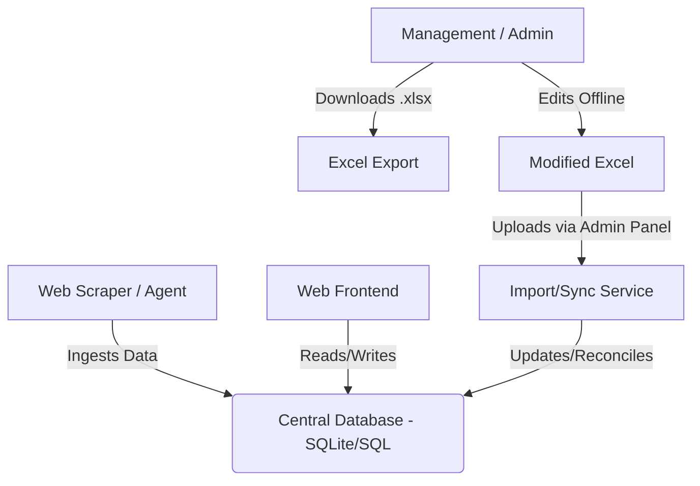

# Data Architecture & Excel Sync Workflow

## Overview
This document outlines the data architecture for the StudyBuddy application, specifically addressing the requirement for "Management" (Non-technical stakeholders) to review and modify data using familiar tools like Microsoft Excel or CSV, while keeping the Web Application as the single source of truth.

## 1. High-Level Architecture

The system follows a **Centralized Database with Batch Synchronization** model.

### Components
1.  **AI Agent / Scraper**: Automatically fetches resources (YouTube, Articles) and populates the database initially.
2.  **Central Database**: The relational database (SQLite for now, extensible to Postgres) holding `Universities`, `Modules` (Courses), `Topics`, and `Resources`.
3.  **Export Engine**: Converts the relational data into a multi-sheet Excel file.
4.  **Import/Sync Engine**: A crucial component that parses uploaded Excel files, identifies changes (New Rows, Modified Cells), and updates the database accordingly.

## 2. Data Model (Schema)

To support the syncing process, the data is organized into the following entities. Note the terminology change from "Course" to "Module" as per requirements.

*   **Universities**: `id`, `name`
*   **Users**: `id`, `username`, `role`, `university_id`
*   **Modules** (Courses): `id`, `module_name`, `module_id` (code), `admin_id`
*   **Topics**: `id`, `name`, `course_id`
*   **Resources**: `id`, `title`, `url`, `format`, `topic_id`, `quality_score`

## 3. The Excel Sync Workflow (Management Interface)

This workflow allows management to audit and correct data without needing direct database access.

### Step 1: Export
*   Admin clicks **"Export Data"** in the Admin Dashboard.
*   The system generates `studybuddy_data.xlsx` with separate sheets:
    *   `Universities`
    *   `Modules`
    *   `Topics`
    *   `Resources`
*   **Crucial Rule**: The `ID` column in the Excel file is the anchor. Management should **never change the ID** of existing rows.

### Step 2: Offline Edit
*   **Modify**: Fix typos in titles, update quality scores, change URLs.
*   **Add**: Add new rows. Leave the `ID` column **blank** for new items. The system will recognize them as new entries.
*   **Delete**: (Optional) In this implementation, rows removed from Excel are strictly *not* deleted from DB to prevent accidental data loss, unless a specific "Delete" column is flagged (safer approach).

### Step 3: Import & Reconcile
*   Admin uploads the modified `.xlsx` via the **"Import Data"** button.
*   **Backend Logic**:
    1.  **Read Excel**: Load sheets into Pandas DataFrames.
    2.  **Iterate Rows**:
        *   **If ID exists**: Find record in DB -> Update fields if changed.
        *   **If ID matches but distinct**: Check for potential conflicts (rare).
        *   **If ID is empty**: Create new record.
    3.  **Commit**: Save changes to the database.
    4.  **Feedback**: Return a summary (e.g., "Updated 5 resources, Created 2 topics").

## 4. Implementation Details

### Database Integrity
The Import Engine respects Foreign Keys. For example, when adding a new `Topic`, the management user must provide a valid `Module ID` (or Name) to link it correctly.

### Security
*   Only users with `admin` or `management` roles can access Export/Import endpoints.
*   Input files are validated to ensure they are valid Excel files before processing.

---
*This architecture ensures high data integrity while providing the flexibility of manual bulk-editing required by management teams.*
